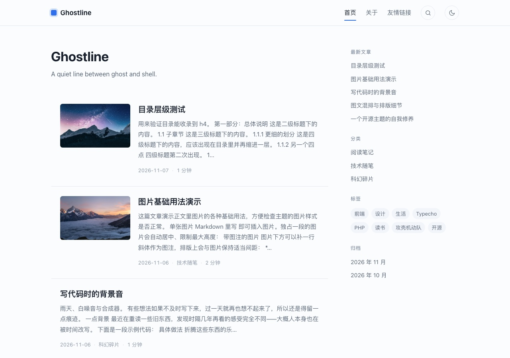
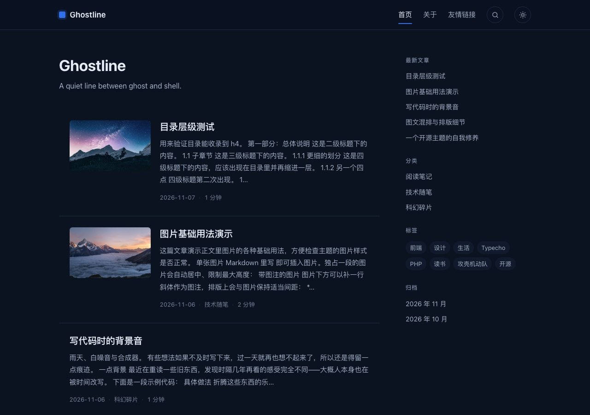

# Ghostline

> a quiet line between ghost and shell.

一个为 [Typecho](https://typecho.org) 写的博客主题：现代、简洁、克制，带一点点冷色调的科幻气质。
名字来自《攻壳机动队》的 *Ghost in the Shell*。

| 浅色 | 深色 |
| :---: | :---: |
|  |  |

## 特性

- **简洁的阅读体验**：全宽文章流 + 可选侧栏，正文排版专注可读性
- **明暗双主题**：默认跟随系统，支持手动切换并记住偏好（无闪烁）
- **文章目录**：自动生成 h2 / h3 / h4 嵌套目录，可逐级折叠，跟随阅读高亮当前章节
- **搜索弹窗**：居中模态搜索，输入即出候选，支持 ↑↓ 选择与 `Cmd/Ctrl + K` 唤起
- **代码块增强**：语法高亮、行号、语言标签、一键复制
- **图片优化**：行内图标对齐、长图限高、灯箱预览（多图可左右切换）
- **阅读进度条**：文章页顶部显示阅读进度
- **文章封面图**：可为每篇文章单独设置列表缩略图
- **上一篇 / 下一篇** 导航、预计阅读时间、返回顶部
- **响应式**：手机、平板、桌面自适应
- **可配置**：强调色、页脚文字、各项功能开关都能在后台调整
- 无前端框架、无构建步骤，纯原生 PHP + CSS + JS

## 环境要求

- Typecho **1.3.0** 或更高
- PHP **7.4+**（推荐 8.1+）

## 安装

### 方式一：下载 zip

1. 下载本仓库的 Release 压缩包
2. 解压后把 `ghostline` 文件夹放进 Typecho 的 `usr/themes/` 目录
3. 登录后台 → **控制台 → 外观** → 启用 **Ghostline**

### 方式二：git clone

```bash
cd /path/to/typecho/usr/themes
git clone https://github.com/fansuregrin1/ghostline.git
```

然后在后台启用即可。

> `usr/themes/ghostline/` 是主题本体。仓库根目录的其他文件（`dev/`）只用于本地开发，不需要部署。

### 重要：中文搜索修复

Typecho 1.3.0 存在一个缺陷：**搜索含中文的关键词会 404**（英文正常）。

原因是 `Archive::searchHandle()` 读取关键词时多套了一层 `'url'` 过滤器，
它内部经过 `parse_url()`，会把 UTF-8 文本破坏成乱码：

```
safeUrl('攻壳') => '�_�壳'
```

这不是主题的问题，任何主题都会遇到。修复只需改一行：

```bash
# 把 /path/to/typecho 换成你的 Typecho 安装目录
bash scripts/fix-search.sh /path/to/typecho
```

手动修复：打开 `var/Widget/Archive.php`，找到 `searchHandle()` 方法，
把这一行

```php
$keywords = $this->request->filter('url', 'search')->get('keywords');
```

改成

```php
$keywords = $this->request->filter('search')->get('keywords');
```

也附带了标准补丁：`patches/typecho-1.3.0-search-chinese.patch`。

## 配置
启用主题后，进入 **控制台 → 外观 → 设置外观**，可以调整：

### 外观与布局

| 选项 | 说明 |
| --- | --- |
| 强调色 | 品牌色，默认暗蓝 `#2f6feb` |
| 顶栏站点标题 | 左上角站名，留空使用站点标题 |
| 首页标题 | 留空显示 `Ghostline` |
| 首页大标题显示 | 可隐藏，避免与顶栏站名重复 |
| 首页副标题 | 留空显示默认文案 |
| 首页副标题显示 | 可隐藏 |
| 首页文章列表样式 | 卡片式 / 经典式 / 紧凑式 |
| 摘要长度 | 列表页摘要字符数，建议 80–200 |
| 侧栏最新文章数量 | 建议 3–10 |

三种列表样式的区别：

| 布局 | 封面图 | 摘要 | 排版 |
| --- | :---: | :---: | --- |
| 卡片式 | ✅ | ✅ | 左图右文 |
| 经典式 | — | ✅ | 纯文字 |
| 紧凑式 | — | — | 仅标题与日期 |

### 正文排版

| 选项 | 说明 |
| --- | --- |
| 正文字体 | 无衬线（系统默认）/ 衬线 |
| 正文字号 | 16 / 17 / 18 / 19 px |
| 正文行高 | 标准 / 宽松（长文更舒适） |

### 代码块

| 选项 | 说明 |
| --- | --- |
| 代码高亮配色 | Ghostline 暗蓝 / GitHub Dark / Monokai |
| 长代码行处理 | 横向滚动 / 自动换行 |

### 个人资料

| 选项 | 说明 |
| --- | --- |
| 博主昵称 | 显示在侧栏卡片 |
| 个人简介 | 显示在侧栏卡片 |
| 头像地址 | 填入图片 URL |
| 社交链接 | 每行一个，格式 `名称|地址` |

### 页脚

| 选项 | 说明 |
| --- | --- |
| 页脚自定义文字 | 支持 HTML，多行输入，留空不显示 |
| ICP 备案号 | 例如 `京ICP备12345678号` |
| 公安备案号 | 例如 `京公网安备 11010502030143号` |
| 版权信息 | 可隐藏「由 Typecho 驱动 · 主题 Ghostline」 |

### 功能开关

| 选项 | 说明 |
| --- | --- |
| 在列表页显示侧栏 | 首页 / 归档页是否显示右侧栏 |
| 在文章页显示文章目录 | 自动生成 h2 / h3 / h4 目录 |
| 显示预计阅读时间 | 按 400 字/分钟估算 |
| 显示返回顶部按钮 | 滚动超过 600px 后出现 |
| 显示上一篇 / 下一篇 | 文章底部导航 |
| 显示阅读进度条 | 文章页顶部进度条 |
| 开放评论区 | 关闭后文章页不渲染评论模块 |

### 文章封面图

编辑文章时，侧边栏底部会多出一个 **「封面图地址」** 字段：

- 填入图片 URL（支持 `https://…` 或站内 `/usr/uploads/…`）
- 保存后，列表页该文章的左侧会显示缩略图
- 留空则保持纯文字样式，两种样式可以混用
- 手机端封面图会自动变成顶部横图


## 开发

仓库自带一套本地开发环境，见 [`dev/README.md`](dev/README.md)。

```bash
# 启动本地站点
php -S 127.0.0.1:8099 -t dev/typecho

# 重新生成测试数据
php dev/seed.php

# 打包主题
bash scripts/package.sh
```

## 目录结构

```
usr/themes/ghostline/
├── screenshot.jpg      后台预览图
├── functions.php       主题配置、自定义字段、辅助函数
├── header.php          公共头部（含搜索弹窗）
├── footer.php          公共页脚
├── sidebar.php         侧栏
├── index.php           首页
├── category.php        分类归档（紧凑标题列表）
├── tag.php             标签归档（紧凑标题列表）
├── post.php            文章详情
├── page.php            独立页面
├── comments.php        评论区
├── 404.php             404 页
├── search-api.php      搜索候选接口（返回 JSON）
├── style.css           样式
└── assets/
    ├── js/main.js      前端交互
    └── js/vendor/highlight.min.js  代码高亮库
```

## 许可

[GPL-3.0](LICENSE) © Ghostline
